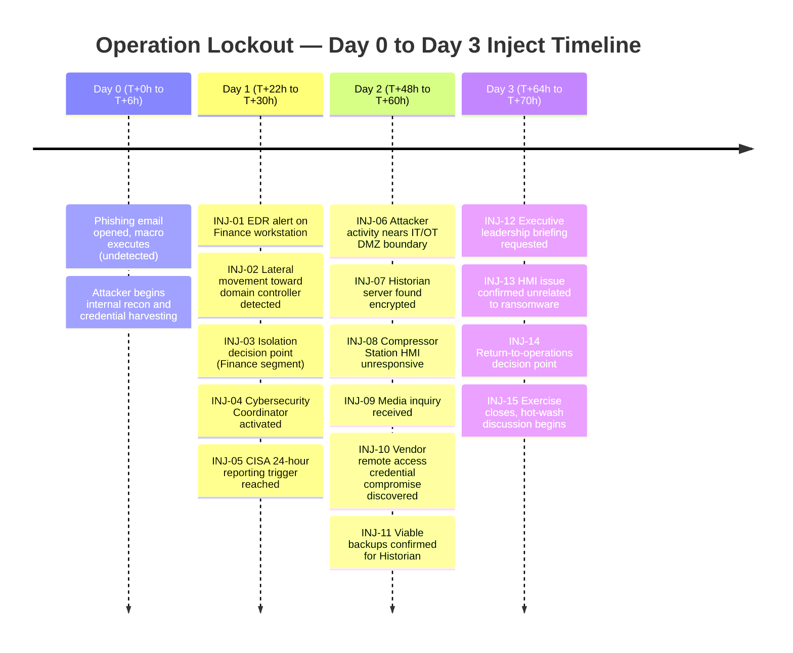

# "Operation Lockout" Exercise Timeline

Sequential inject timeline for the full-scale annual tabletop exercise (see [facilitator guide](../docs/ttx-facilitator-guide.md)).

**Design intent:** the timeline deliberately separates the *detection point* (Day 1, T+22h) from the *actual compromise point* (Day 0, T+0h) by 22 hours — this gap is itself a discussion point in the facilitator's closing questions, since it mirrors real-world dwell-time patterns reported by CISA for nation-state and ransomware intrusions into critical infrastructure IT networks.
